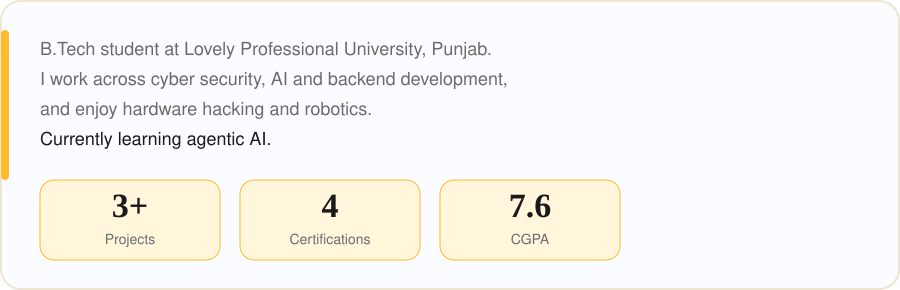
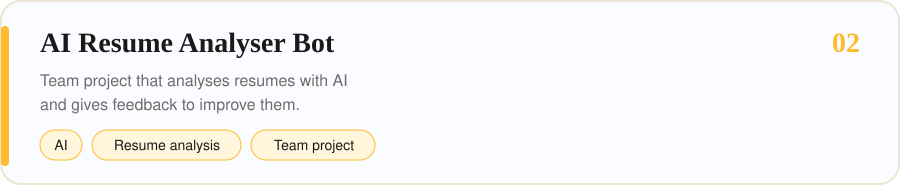
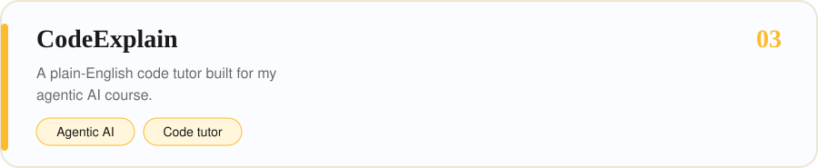
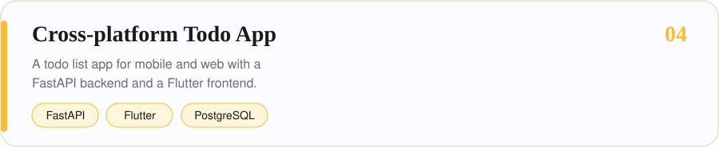
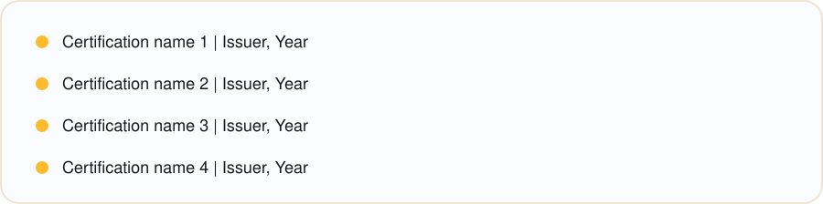
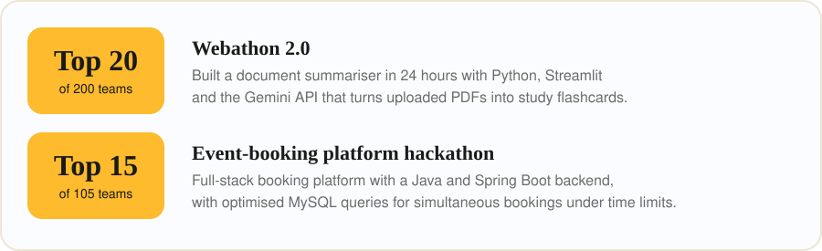
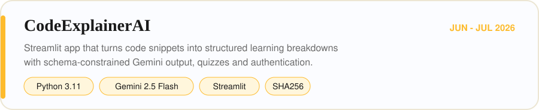
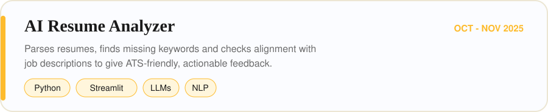
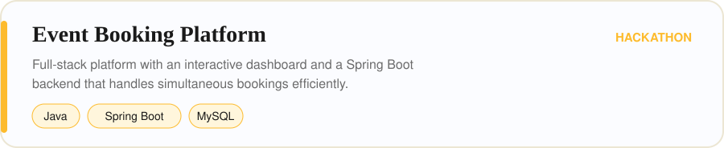

<<<<<<< HEAD

=======

>>>>>>> cf1052d (Updated)

<<<<<<< HEAD

<picture>
  <source media="(prefers-color-scheme: dark)" srcset="https://raw.githubusercontent.com/YOUR_USERNAME/YOUR_USERNAME/output/github-snake-dark.svg">
  
</picture>

=======

<picture>
  <source media="(prefers-color-scheme: dark)" srcset="https://raw.githubusercontent.com/Abhinav09060/abhinav09060/output/github-snake-dark.svg">
  
</picture>

  
  
  

>>>>>>> cf1052d (Updated)

