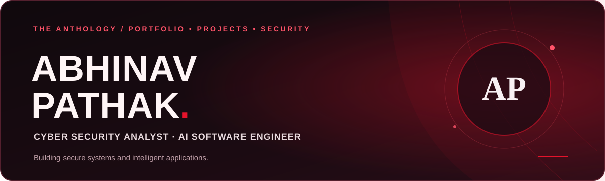
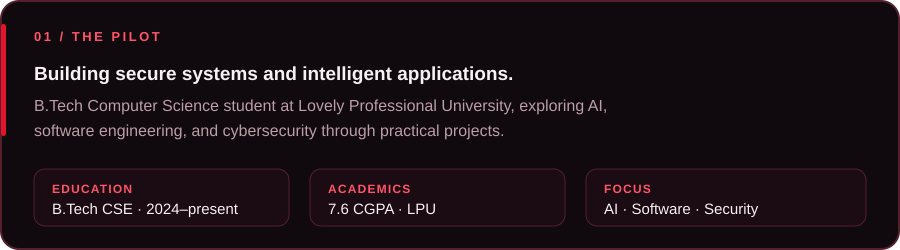
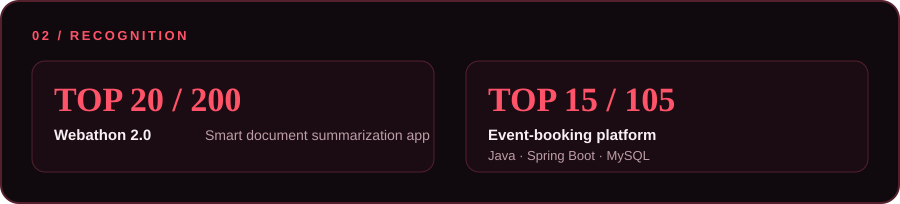
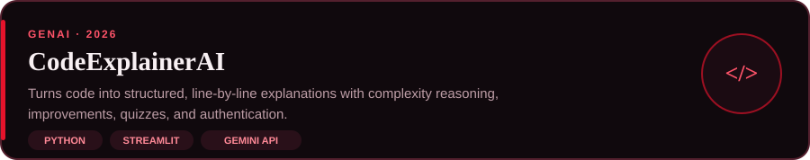
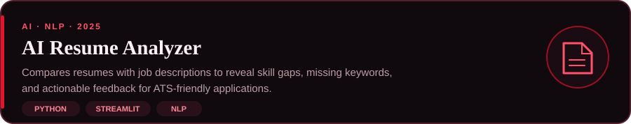
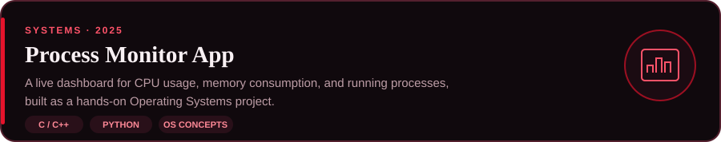
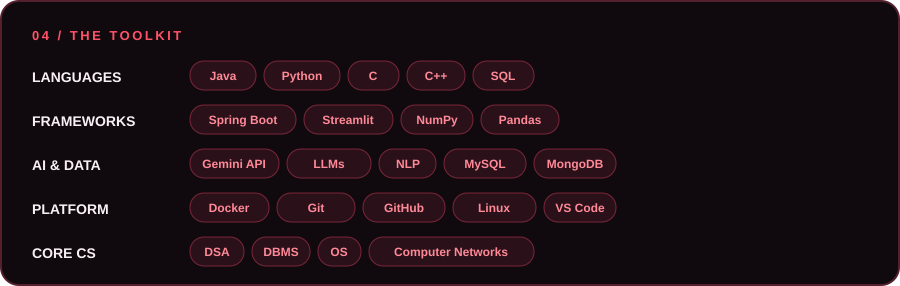
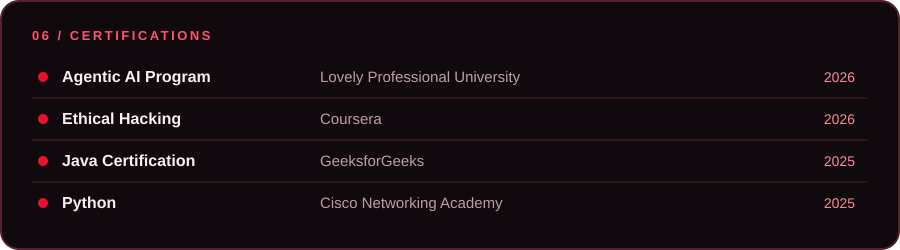

  
  
  
  

<h2 align="center">03 &nbsp; / &nbsp; SELECTED ORIGINALS</h2>

  

  

  

<h2 align="center">05 &nbsp; / &nbsp; THE COMMIT LOG</h2>

  

<picture>
  <source media="(prefers-color-scheme: dark)" srcset="https://raw.githubusercontent.com/Abhinav09060/abhinav09060/output/github-snake-dark.svg">
  
</picture>

  
  
  

  

